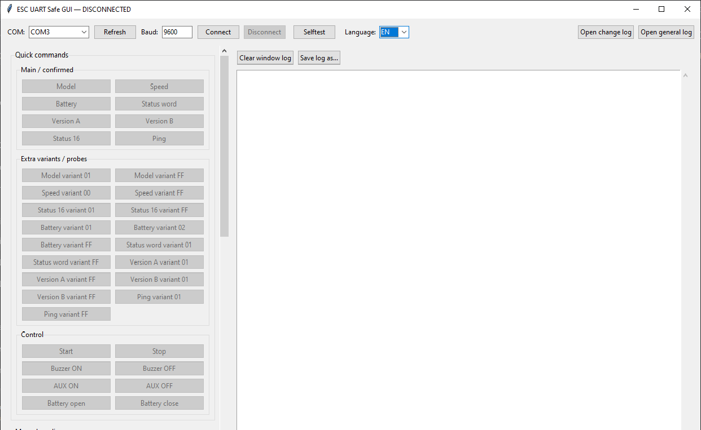

# ESC UART GUI

Python/Tkinter workbench for logging, decoding and exploring the UART protocol of a scooter ESC. Developed from hardware tests and TX/RX captures for the TTC controller project.

[Polski](README.pl.md) · [Setup and usage](docs/USAGE.md) · [Protocol reference](docs/PROTOCOL.md) · [Source](esc_uart_gui_tkinter.py)

## Run

Requires **Python 3.10+**, Tkinter, a USB–UART adapter and `pyserial`. The project is intended for Windows and Linux.

```bash
python -m pip install -r requirements.txt
python esc_uart_gui_tkinter.py
```

Select the serial port, leave **9600 baud** as the initial setting, then connect. Installation details and generated log files are described in the [usage guide](docs/USAGE.md).



## Features

| Area | Included |
| --- | --- |
| Communication | Serial port selection, manual HEX payloads, automatic CRC32/MPEG-2 |
| Commands | Readouts, start/stop, buzzer, AUX and battery lock controls |
| Analysis | Battery, speed, model, firmware and status decoding; TX/RX logs |
| Discovery | Range scan, Smart Tree Scan and step-by-step autotest |
| Interface | Polish/English labels, scrollable controls and saved window geometry |

## Protocol status

This is a reverse-engineering tool for the observed protocol. Other controllers and firmware revisions need separate verification. Longer RX frames may show `CRC ?`; their checksum interpretation remains unresolved.

Commands change real hardware state. Use a bench setup with the wheel clear. The application blocks the suspected OTA/flash prefixes `0F 02` and `0F 03`; this does not establish that other unknown commands are harmless. See the [protocol reference](docs/PROTOCOL.md) before scanning.

## Support

If the project helped you, you can [support it on BuyCoffee.to](https://buycoffee.to/arasusx-cyber), report a reproducible issue or share your findings.
